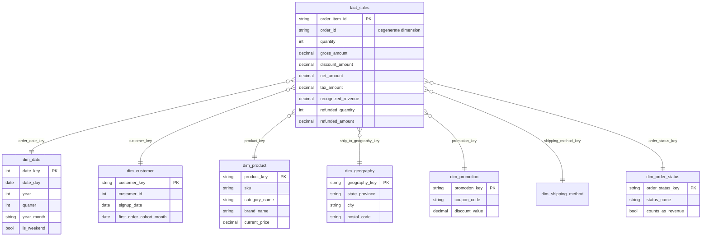

# E-commerce Data Warehouse & Customer Analytics

A data-engineering portfolio project that turns 31 raw e-commerce CSV files into
a tested **star schema for sales analytics**, built with **dbt Core and DuckDB**
and organised in three layers: staging → intermediate → marts.

## Project at a glance

| | |
|---|---|
| Source | 31 generated CSV tables, ~264K rows (7K customers, 36K orders, 100K order items, 2021–2025) |
| Models | 54 (31 staging, 5 intermediate, 8 dimensions, 5 core facts, 5 marts) |
| Tests | 232 data tests: keys, relationships, accepted values, and business-rule tests |
| Other dbt features | seed, snapshot (SCD2), macros, `dbt_utils`, analyses |
| Warehouse | DuckDB (local file) |

## Architecture

```text
31 CSV files
    │  scripts/load_csvs.py                      (Extract + Load)
    ▼
DuckDB  raw.*
    │
    ▼  dbt                                        (Transform)
staging        31 views   rename, cast, clean, drop PII — one model per source table
    │
    ▼
intermediate    5 views   joins, order-grain rollups, business rules (revenue definition)
    │
    ▼
marts          18 tables
    ├── core        star schema: 8 dimensions + 5 facts
    ├── sales       mart_sales_daily, mart_product_performance
    ├── customer    mart_customer_360 (RFM segments)
    └── operations  fact_inventory_current, fact_support_tickets
```

### What each layer does

| Layer | Question it answers | Rules |
|---|---|---|
| **Staging** | What is in the source? | 1:1 with source tables. Rename keys (`id` → `order_id`), cast types (money → `decimal(18,2)`), normalise text, drop `password_hash`. No joins. |
| **Intermediate** | How do the tables fit together? | Joins and rollups reused by several marts. Business rules are defined **once** here, e.g. which order statuses count as revenue. |
| **Marts** | What do analysts need? | Facts and dimensions with surrogate keys and documented grains. Materialised as tables. |

## Star schema

`fact_sales` is the central fact at **order-item grain**. Each foreign key points
to a dimension built with `dbt_utils.generate_surrogate_key`.



Other facts keep their own grain and share the same (conformed) dimensions:

| Fact | Grain | Use for |
|---|---|---|
| `fact_sales` | order item | revenue, units, discounts by product / category / date / location |
| `fact_orders` | order | order counts, AOV, shipping cost, order totals |
| `fact_payments` | payment transaction | payment method mix, failed / refunded payments |
| `fact_shipments` | shipment | days to ship, transit time, on-time delivery |
| `fact_returns` | return request | return reasons and refund amounts |

## Design decisions

**1. Sum each measure only at its own grain.** `order_total` is an order-level
amount. Joining `fact_orders` to `fact_sales` and summing it repeats each order
once per line: the total grows from 10.8M to 40.2M (3.7×) with no error. See
[`analyses/fanout_revenue_inflation.sql`](analyses/fanout_revenue_inflation.sql).

**2. One revenue definition.** The same data gives very different "revenue":

| Definition | Amount |
|---|---|
| All order totals, any status | 10.77M |
| Completed payments | 10.06M |
| Net sales, any status (before tax and shipping) | 9.32M |
| **Recognized revenue** (paid, shipped, delivered; before tax and shipping) | **5.49M** |

Which statuses count is a business rule kept in the
[`order_status_mapping`](seeds/order_status_mapping.csv) seed and applied once in
`int_orders__enriched`. See [`analyses/revenue_definitions.sql`](analyses/revenue_definitions.sql).

**3. Order discounts are allocated to lines.** The source only has discounts at
order level (line discounts are always 0). `int_order_items__enriched` spreads
each order discount across its lines by gross amount, so `net_amount` in
`fact_sales` is correct at any level of aggregation. A singular test checks that
lines add back up to the order header.

**4. "No promotion" row instead of null keys.** Orders without a coupon point to
a `coupon_id = -1` row in `dim_promotion`, so every fact row joins to every
dimension.

**5. Geography is a location, not a person.** `dim_geography` keeps country,
state, city and postal code, not street addresses. In this generated data the
ship-to address usually belongs to another user, so geography is modelled as the
ship-to location of the order rather than an attribute of the customer.

**6. No incremental models yet.** Orders change status after they are created,
but the source has no `updated_at` column, so an incremental filter would miss
those changes. At 100K rows a full rebuild takes seconds.

## Data quality

- Primary keys: `unique` + `not_null` on every source, staging model, dimension and fact.
- Foreign keys: `relationships` tests from every fact key to its dimension.
- Categorical columns: `accepted_values` on statuses, priorities and RFM segments.
- Business rules (`tests/`):
  - `assert_fact_sales_reconciles_to_orders`: line gross and allocated discounts equal the order header.
  - `assert_no_revenue_from_non_revenue_statuses`: pending, cancelled and refunded orders add no revenue.
  - `warn_orders_without_items` (**warning**): 2,258 orders have no items (subtotal 0, total = shipping). Reported on every build without blocking it.

## Repository layout

```text
data/raw/ecommerce_100k/        source CSVs
scripts/load_csvs.py            CSV → DuckDB raw schema
models/
  staging/ecommerce/            stg_ecommerce__*  + _ecommerce__sources.yml, _ecommerce__models.yml
  intermediate/                 int_*             + _int__models.yml
  marts/
    core/                       dim_*, fact_*     + _core__models.yml
    sales/                      mart_sales_daily, mart_product_performance
    customer/                   mart_customer_360
    operations/                 fact_inventory_current, fact_support_tickets
seeds/                          order_status_mapping.csv (business rules)
snapshots/                      snap_products (SCD2 price history)
macros/                         generate_schema_name, to_money, date_key
tests/                          singular business-rule tests
analyses/                       fan-out and revenue-definition queries
```

DuckDB schemas match the folders: `staging`, `intermediate`, `core`, `sales`,
`customer`, `operations`, `seeds`, `snapshots`.

## Run locally

Requirements: Python 3.9+.

```powershell
python -m venv .venv
.\.venv\Scripts\Activate.ps1
python -m pip install -r requirements.txt
python scripts\load_csvs.py          # load CSVs into warehouse/ecommerce.duckdb
dbt deps --profiles-dir .            # install dbt_utils
dbt build --profiles-dir .           # seed, run, snapshot and test everything
dbt docs generate --profiles-dir .   # then: dbt docs serve --profiles-dir .
```

`profiles.yml` holds a local DuckDB profile only; do not put credentials in it.

## Limitations and next steps

- Data is generated: some relationships are random (ship-to addresses, all
  categories top level, one country), so results show the method, not real
  business insight.
- Inventory is current state only; schedule `snap_products`-style snapshots of
  inventory to analyse stock over time.
- Add a BI layer (Power BI) on the star schema for sales trends, cohorts and returns.
